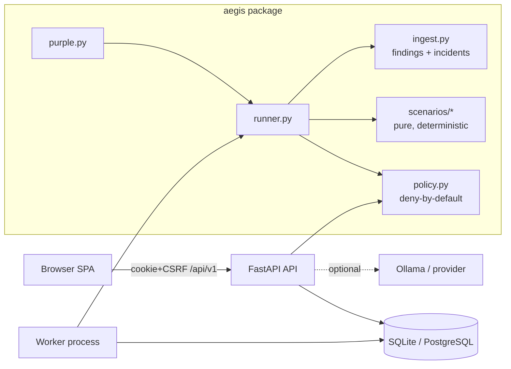

# Architecture

## Data flow of one verified fix
1. `POST /purple/cases` → pre-flight policy check → `jobs` row (idempotent, no duplicate active run per target).
2. Worker claims the job (conditional UPDATE), then for each step: re-check policy (+kill switch, cancel, rate limit) → run step → write progress.
3. `finalize` returns a deterministic result; a `runs` row stores state snapshot + hash, steps/policy trail, result, HMAC-signed manifest.
4. `ingest` upserts findings (stable ID = hash(target, rule, location)) and incidents; absent findings become `VERIFIED_FIXED`.
5. Analyst approves → single-use `approvals` row (target, action, exact params digest, 15 min) → `apply` mutates the fixture only, keeping `prior_state` for rollback.
6. Retest job runs the same scenario version; `purple.compare` computes before/after metrics from stored runs.

## Key modules
| Module | Responsibility |
|---|---|
| `policy.py` | Pure scope/policy logic, no I/O |
| `scenarios/` | Versioned fixtures + steps; same input ⇒ identical result hash |
| `cloud.py` | Offline IAM/Terraform analysis, mini IAM evaluator |
| `assistant.py` | Provider adapters, deterministic explanations, Verifier, Coordinator plan |
| `audit.py` | Hash-chained audit log |
| `reports.py` | Escaped HTML / JSON reports |

Entities: users, sessions, targets, approvals, jobs, runs, purple_cases, findings, incidents, audit_entries, settings,
detection_rule_versions, analyses (migration `0001`).
